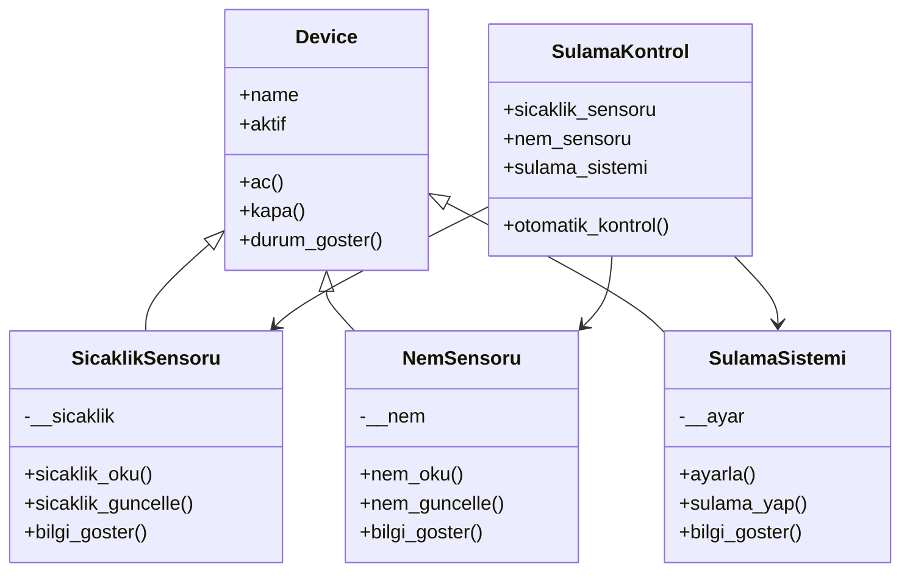

# UML Sınıf Diyagramı

Bu diyagram, Akıllı Sulama Sistemi projesinin
nesne yönelimli sınıf yapısını göstermektedir.

## Sınıf Diyagramı

## Diyagram Açıklaması

- Device: Bütün cihazların ortak özelliklerini içerir.
- SicaklikSensoru: Sıcaklık verisini okur ve günceller.
- NemSensoru: Nem verisini okur ve günceller.
- SulamaSistemi: Sulama işlemini yönetir.
- SulamaKontrol: Sensörlerden gelen verileri değerlendirerek sulama kararını verir.

Diyagram, kalıtım ve sınıflar arası ilişkileri göstermektedir.
